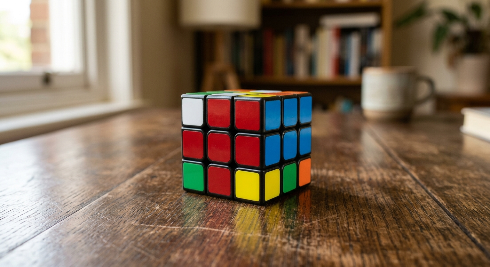

# Rubik's Cube
The mathematics behind the Rubik's cube... 

## Author
DOHEMETO Bonaventure

## Illustration

## Table of Contents
- [Introduction](#introduction)
- [Probability Aspects](#probability-aspects)
- [Group Theory](#group-theory)
- [Other Mathematical Aspects](#other-mathematical-aspects)
- [Solving Strategies and Tips](#solving-strategies-and-tips)
- [Conclusion](#conclusion)

## Introduction

## Probability Aspects

## Group Theory

## Other Mathematical Aspects

## Solving Strategies and Tips

## Conclusion

$$
\sum_{i=1}^{n} i = \frac{n(n+1)}{2}
$$